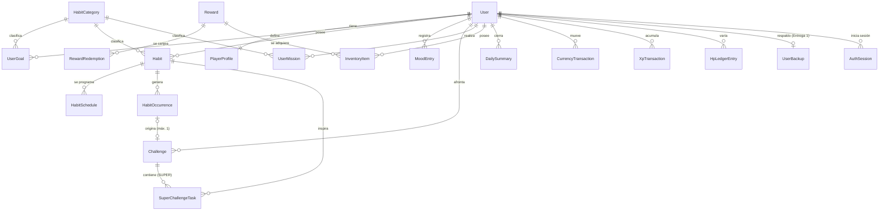

# Modelo de datos — The Life Game

> Equipo TechPhic · v1.2 (2026-11-25, segunda revisión de la Fase 0) · **Estado: PROPUESTA. El equipo la aprueba en la Fase 1.**

> ⚠️ No se crean tablas ni migraciones hasta aprobar este modelo en la Fase 1. Las migraciones siguen el procedimiento de P-45 (scripts SQL numerados). **[R]** marca una recomendación técnica y **[P-xx]** depende de una decisión del equipo.

## 1. Convenciones

| Aspecto | Convención | Motivo |
|---|---|---|
| Entidades | `PascalCase` en singular: `HabitOccurrence` | Coherencia con el Doc §15.2. |
| Tablas y columnas | `snake_case`, tablas en plural: `habit_occurrences.game_date` | Convención SQL. La API usa `camelCase`. |
| Identificadores | **UUID v4** generado en el cliente. MySQL: `CHAR(36)`; SQLite: `TEXT`; futuro PostgreSQL: `uuid`. | Datos creados sin conexión y portabilidad (R-05, R-30). |
| Marcas de tiempo | **UTC**. MySQL: `DATETIME(3)`; SQLite: texto ISO-8601. Sufijo `_at`. | Sin ambigüedad horaria. |
| Fecha de jornada | `game_date` (`DATE`, `YYYY-MM-DD`). | RN-DAY-02. |
| Enumeraciones | `VARCHAR` + `CHECK`, valores en `UPPER_SNAKE_CASE`. **Nunca `ENUM`.** | Portable a SQLite y PostgreSQL (R-30). |
| Booleanos | `BOOLEAN` (en MySQL es un alias de `TINYINT(1)`; nativo en PostgreSQL). | Portable. |
| Cantidades | **Enteros**: Hojas, XP y unidades de HP. | Sin coma flotante. |
| Versionado | `version` + `updated_at` en las entidades editables. | Preparado para la sincronización de la Fase 11. |
| Borrado | Lógico (`archived_at`) donde hay historial. Los **libros de movimientos solo admiten inserciones**. | Integridad (C-07). |
| Motor | InnoDB, `utf8mb4_unicode_ci`. Verificar si XAMPP usa MariaDB (R-22). | — |
| Portabilidad | Evitar `ENUM`, `UNSIGNED`, `ON UPDATE CURRENT_TIMESTAMP`, comillas invertidas y funciones exclusivas de MySQL (R-30). | Posible migración a Supabase (P-51). |

## 2. Vista general

## 3. Entidades

### 3.1. Cuenta y perfil

#### User — cuenta
| Campo | Tipo | Notas |
|---|---|---|
| `id` | UUID | PK. |
| `username` | texto | Tal como lo escribió el usuario (se muestra). |
| `username_normalized` | texto | En minúsculas. **UNIQUE**: unicidad sin distinguir mayúsculas (RN-AUTH-02). |
| `email` | texto | Guardado en minúsculas. **UNIQUE**. |
| `password_hash` | texto | **Solo en el servidor** (bcryptjs). Nunca se envía a la app. |
| `purpose` | texto | Propósito personal. |
| `privacy_accepted_at` | marca | Consentimiento del aviso de privacidad (C-25). |
| `created_at`, `updated_at`, `version` | — | — |

El inicio de sesión busca por `username_normalized` **o** por `email` (RN-AUTH-07).

#### AuthSession — sesión *(solo servidor)*
| Campo | Tipo | Notas |
|---|---|---|
| `id` | UUID | PK. |
| `user_id` | UUID | FK → User. |
| `token_hash` | texto | SHA-256 del token opaco. **UNIQUE**. El token en claro solo existe en la app (SecureStore). |
| `expires_at` | marca | Creación + 30 días (R-16). |
| `revoked_at` | marca \| null | Se rellena al cerrar sesión. |
| `created_at`, `last_used_at` | marca | — |

#### PlayerProfile — estado de juego (1:1)
| Campo | Tipo | Notas |
|---|---|---|
| `user_id` | UUID | PK y FK. |
| `level` | entero ≥ 0 | Inicial **0** (C-05). Derivado de `xp_total` (P-03). |
| `xp_total` | entero ≥ 0 | Inicial **0**. |
| `mate_leaves_balance` | entero ≥ 0 | Inicial **0**. |
| `hp_half_units` | entero 0..20 | Inicial **20**. |
| `perfect_streak` | entero ≥ 0 | RN-CLOSE-07. |
| `avatar_appearance` | texto (JSON) | Apariencia base del avatar (P-38). |
| `last_closed_game_date` | fecha \| null | Base de la reconciliación. |
| `updated_at`, `version` | — | — |

Restricciones: `CHECK (hp_half_units BETWEEN 0 AND 20)`, `CHECK (mate_leaves_balance >= 0)`, `CHECK (xp_total >= 0)`, `CHECK (level >= 0)`.

#### UserGoal — meta
| Campo | Tipo | Notas |
|---|---|---|
| `id` | UUID | PK. |
| `user_id` | UUID | FK. |
| `text` | texto | Texto libre (P-41). |
| `category_id` | texto | FK → HabitCategory. Sirve para elegir los mensajes. |
| `sort_order`, `archived_at`, `created_at`, `updated_at` | — | — |

### 3.2. Hábitos

#### HabitCategory — catálogo
| Campo | Tipo | Notas |
|---|---|---|
| `id` | texto | PK, código estable (P-42): `EXERCISE`, `STUDY`, `READING`, `ART`, `MINDFULNESS`, `HEALTH`, `SELF_CARE`, `HOME`, `FINANCE`, `SOCIAL`, `WORK`, `SPIRITUALITY`, `DIGITAL_WELLBEING`, `HOBBIES`, `COMMUNITY`, `OTHER`. |
| `name` | texto | Nombre en español. |
| `sort_order` | entero | — |

Es un catálogo fijo, incluido en la app y sembrado en el servidor.

#### Habit
| Campo | Tipo | Notas |
|---|---|---|
| `id` | UUID | PK. |
| `user_id` | UUID | FK. |
| `origin` | `RECOMMENDED` \| `CUSTOM` | En la Entrega 1, solo `CUSTOM` (P-04 aplazada). |
| `category_id` | texto | FK → HabitCategory. **Obligatorio** (RN-HAB-09). |
| `name` | texto | — |
| `target_quantity` | entero > 0 | Cantidad medible (RN-HAB-08). |
| `unit` | texto | `MINUTES`, `PAGES`, `REPETITIONS`, `KILOMETERS`, `GLASSES`, `TIMES` o texto libre si es "otra". |
| `mate_leaves_reward` | entero | `CHECK (mate_leaves_reward IN (0,5,10,15,20,25,30))` (C-06). |
| `xp_reward` | entero | `CHECK (xp_reward IN (0,10,20,30,40,50))` (P-54). |
| `archived_at` | marca \| null | Eliminación lógica. |
| `created_at`, `updated_at`, `version` | — | — |

#### HabitSchedule
| Campo | Tipo | Notas |
|---|---|---|
| `id` | UUID | PK. |
| `habit_id` | UUID | FK. |
| `type` | `WEEKLY` \| `SPECIFIC_DATE` | — |
| `weekdays` | entero (máscara de 7 bits) \| null | Bit 0 = lunes … bit 6 = domingo. |
| `specific_date` | fecha \| null | — |
| `valid_from`, `valid_to` | fecha | Vigencia. |
| `created_at`, `updated_at`, `version` | — | — |

#### HabitOccurrence — historial de cumplimiento
| Campo | Tipo | Notas |
|---|---|---|
| `id` | UUID | PK. Base de las claves de idempotencia. |
| `user_id`, `habit_id` | UUID | FK. |
| `game_date` | fecha | — |
| `status` | `PENDING` \| `COMPLETED` \| `MISSED` \| `CANCELLED` \| `PAUSED` | `PAUSED` solo si se aprueba P-50. |
| `habit_name_snapshot`, `category_id_snapshot` | texto | Copia (R-13). |
| `target_quantity_snapshot`, `unit_snapshot` | entero, texto | Copia para calcular los desafíos. |
| `mate_leaves_reward_snapshot`, `xp_reward_snapshot` | entero | Copia (RN-HAB-05). |
| `resolved_at` | marca \| null | Hora real del registro. Define la ventana de deshacer de 10 s (RN-DAY-07). |
| `resolution_source` | `USER` \| `DAY_CLOSE` \| null | Deshacer Día Finalizado devuelve a `PENDING` las ocurrencias de esa jornada con `DAY_CLOSE` (RN-CLOSE-09). |
| `created_at`, `updated_at`, `version` | — | — |

Restricciones: `UNIQUE(habit_id, game_date)` (P-43). Índice `(user_id, game_date)`.

### 3.3. Estado de ánimo

#### MoodEntry
| Campo | Tipo | Notas |
|---|---|---|
| `id` | UUID | PK. |
| `user_id` | UUID | FK. |
| `game_date` | fecha | — |
| `mood` | `VERY_HAPPY` \| `GOOD` \| `NEUTRAL` \| `DOWN` \| `VERY_BAD` | — |
| `recorded_at` | marca | El **último** de la jornada prevalece (C-28). |

Hay varios registros por jornada. Índice `(user_id, game_date, recorded_at)`.

### 3.4. Desafíos

#### Challenge
| Campo | Tipo | Notas |
|---|---|---|
| `id` | UUID | PK. |
| `user_id` | UUID | FK. |
| `kind` | `MISSED_HABIT` \| `RECOVERY` \| `SUPER` | — |
| `variant` | `NORMAL` \| `MINI` \| null | Solo para `MISSED_HABIT`. **Mutable** mientras la jornada de origen esté abierta (RN-MOOD-08). |
| `source_occurrence_id` | UUID \| null | FK. **UNIQUE** (R-15). Obligatorio en `MISSED_HABIT`. |
| `source_game_date` | fecha \| null | Jornada de origen, para saber si la variante sigue siendo mutable. |
| `habit_id` | UUID \| null | Hábito relacionado (`MISSED_HABIT` y `RECOVERY`). |
| `target_quantity`, `unit` | entero, texto | Criterio medible (P-07). Se recalcula si cambia la variante. |
| `title` | texto | Acción mostrada ("Estudiar programación 6 min"). |
| `status` | `PENDING` \| `COMPLETED` \| `DECLINED` \| `EXPIRED` \| `CANCELLED` | `BUSINESS_RULES.md` §16. |
| `deadline_at` | marca \| null | `created_at + 72 h` en `MISSED_HABIT`. `null` en `SUPER` y en `RECOVERY` (sin plazo). |
| `grace_applied` | booleano | Gracia de 12 h ya usada (INT-18). |
| `declined_at` | marca \| null | Rechazo del mini. |
| `mate_leaves_reward` | entero | `MISSED_HABIT` y `RECOVERY`: `floor(Hojas de la ocurrencia / 2)` (P-49). `SUPER`: 0. |
| `xp_reward` | entero | `MISSED_HABIT` y `RECOVERY`: 20 % de la XP de la ocurrencia (siempre entero). `SUPER`: 0. |
| `source_penalty_id` | UUID \| null | `RECOVERY`: el movimiento de HP (vida perdida) que lo originó. **UNIQUE**: un desafío de recuperación por vida perdida (P-12). |
| `completed_at`, `resolved_at` | marca \| null | — |
| `created_at`, `updated_at`, `version` | — | — |

Restricciones:
- `UNIQUE(source_occurrence_id)`: admite varios `NULL`, tanto en MySQL como en SQLite y PostgreSQL.
- **Un `SUPER` en `PENDING` por usuario**, validado en el servicio dentro de una transacción.
- Índice `(user_id, status, deadline_at)`.

#### SuperChallengeTask — retos del Superdesafío
| Campo | Tipo | Notas |
|---|---|---|
| `id` | UUID | PK. |
| `challenge_id` | UUID | FK → Challenge (`kind = SUPER`). |
| `habit_id` | UUID | Uno por hábito activo al activarse (P-13). |
| `title`, `target_quantity`, `unit` | — | Tamaño normal (P-07). |
| `status` | `PENDING` \| `COMPLETED` | — |
| `completed_at` | marca \| null | — |

Restricción: `UNIQUE(challenge_id, habit_id)`. El Superdesafío se completa cuando **todas** sus tareas están `COMPLETED`.

### 3.5. Misiones secundarias

#### UserMission
| Campo | Tipo | Notas |
|---|---|---|
| `id` | UUID | PK. |
| `user_id` | UUID | FK. |
| `game_date` | fecha | Límite: **3 por `(user_id, game_date)`**, validado en el servicio (INT-20). |
| `category_id` | texto | Categoría elegida en el modal. |
| `description` | texto | Sugerida por la app y **editable** por el usuario (C-31). |
| `target_quantity`, `unit` | entero, texto | Criterio medible. |
| `mate_leaves_reward`, `xp_reward` | entero | Copia de **20 / 20** (configurable). |
| `status` | `ACCEPTED` \| `COMPLETED` \| `ABANDONED` | — |
| `accepted_at`, `completed_at` | marca | — |

Las sugerencias se generan en la app a partir de las metas y los hábitos de la categoría, con plantillas de `src/content/`. No hace falta una tabla de catálogo.

### 3.6. Tienda e inventario

#### Reward
| Campo | Tipo | Notas |
|---|---|---|
| `id` | UUID | PK. |
| `owner_user_id` | UUID \| null | `REAL_LIFE`: el usuario que la creó. `COSMETIC`: `null` (catálogo del equipo). |
| `type` | `REAL_LIFE` \| `COSMETIC` | — |
| `name`, `description` | texto | — |
| `cost_mate_leaves` | entero | `REAL_LIFE`: **≥ 20**, sin máximo (C-30). `COSMETIC`: según el catálogo (P-16). |
| `min_level` | entero \| null | Solo `COSMETIC`. |
| `cosmetic_slot` | `HEAD` \| `FACE` \| `NECK` \| `CHEST` \| `HANDS` \| `LEGS` \| `FEET` \| null | Solo `COSMETIC` (C-22, RN-SHOP-04). |
| `asset_key` | texto \| null | Sprite pixel art. |
| `is_active`, `archived_at` | — | — |

Restricciones:
- `CHECK (type = 'REAL_LIFE' OR owner_user_id IS NULL)`.
- `CHECK (type = 'COSMETIC' OR (min_level IS NULL AND cosmetic_slot IS NULL))`.
- `CHECK (cost_mate_leaves > 0 AND (type <> 'REAL_LIFE' OR cost_mate_leaves >= 20))`.
- **Los cosméticos no entran en la Entrega 1.** La tabla puede existir, pero sin artículos `COSMETIC`.

#### RewardRedemption — canje de una recompensa real
`id` (= `operationId`), `user_id`, `reward_id`, `name_snapshot`, `cost_snapshot`, `currency_transaction_id`, `redeemed_at`. Los canjes son ilimitados, cada uno con su propio ID.

#### InventoryItem
| Campo | Tipo | Notas |
|---|---|---|
| `id` | UUID | PK. |
| `user_id`, `reward_id` | UUID | FK. **UNIQUE(user_id, reward_id)**. |
| `cosmetic_slot` | texto | Copia de la ranura. |
| `is_equipped` | booleano | Uno equipado por ranura, validado en el servicio. |
| `acquired_at`, `currency_transaction_id` | — | — |

### 3.7. Jornadas

#### DailySummary
| Campo | Tipo | Notas |
|---|---|---|
| `id` | UUID | PK. |
| `user_id` | UUID | FK. |
| `game_date` | fecha | **UNIQUE(user_id, game_date)** (INT-09). |
| `scheduled_count`, `completed_count`, `missed_count` | entero | Se guarda la fracción (clasificación sin redondear). |
| `classification` | `PERFECT` \| `VERY_GOOD` \| `PARTIAL` \| `CRITICAL` \| `NO_ACTIVITY` (\| `PAUSED` si se aprueba P-50) | — |
| `last_mood` | enum \| null | Último estado de ánimo de la jornada (RN-MAP-08). |
| `streak_after` | entero | — |
| `message_id` | texto \| null | Mensaje mostrado (ID del JSON). |
| `close_source` | `MANUAL` \| `AUTO` | — |
| `closed_at` | marca | — |

### 3.8. Libros de movimientos (solo se insertan filas)

| Entidad | Campos | Tipos de movimiento |
|---|---|---|
| **CurrencyTransaction** | `id`, `user_id`, `amount` (con signo), `type`, `source_type`, `source_id`, `idempotency_key` **UNIQUE**, `balance_after`, `created_at` | `HABIT_REWARD`, `CHALLENGE_REWARD`, `MISSION_REWARD`, `REWARD_REDEMPTION`, `COSMETIC_PURCHASE`, `UNDO_REVERSAL` |
| **XpTransaction** | `id`, `user_id`, `amount`, `type`, `source_type`, `source_id`, `idempotency_key` **UNIQUE**, `xp_total_after`, `created_at` | `HABIT_REWARD`, `CHALLENGE_REWARD`, `MISSION_REWARD`, `UNDO_REVERSAL` |
| **HpLedgerEntry** | `id`, `user_id`, `reason`, `delta_requested`, `delta_applied`, `source_type`, `source_id`, `idempotency_key` **UNIQUE**, `hp_after` (0..20), `created_at` | `MISSED_HABIT_PENALTY`, `RECOVERY`, `ZERO_HP_RECOVERY`, `SUPER_CHALLENGE` |

**Deshacer** (RN-DAY-07) no borra movimientos: inserta un movimiento compensatorio `UNDO_REVERSAL` con la clave `undo:<occurrenceId>:<n>`.

### 3.9. Configuración y contenido (datos en la app)

| Entidad | Contenido | Estado |
|---|---|---|
| **LevelThreshold** | `level`, `xp_required_total`. Propuesta: `40·n² + 60·n` (P-03). | Generada desde la configuración |
| **MotivationalMessage** | `id`, `text`, `context` (`APP_OPEN`, `DAY_CLOSE`, `MINI_CHALLENGE`, `PAST_DAY`), `mood`, `performance`, `category_id`, `tone` | JSON local (P-32) |
| **CosmeticCatalog** | Filas `Reward` de tipo `COSMETIC` | Entrega 1: 2–3 (P-16) |

### 3.10. Respaldo y sincronización

| Entidad | Ubicación | Notas |
|---|---|---|
| **UserBackup** | Servidor | `user_id` (PK), `snapshot` (texto JSON; `LONGTEXT` en MySQL), `schema_version`, `checksum`, `size_bytes`, `updated_at`. **Entrega 1** (R-29): una fila por usuario, que se sustituye en cada respaldo. |
| **SyncOutbox**, **SyncState** | App | **Fase 11** (R-07, R-27 aplazadas). |
| **ProcessedOperation** | Servidor | **Fase 11**. |

## 4. Dónde vive cada dato

| Entidad | App (SQLite) | Servidor (MySQL) | Entrega 1 |
|---|:-:|:-:|---|
| User (sin `password_hash`), AuthSession | Parcial | ✔ | Tablas reales en el servidor. |
| Token de sesión | SecureStore | Hash en AuthSession | — |
| PlayerProfile, UserGoal, Habit, HabitSchedule, HabitOccurrence, MoodEntry, Challenge, SuperChallengeTask, UserMission, Reward (personalizadas), RewardRedemption, InventoryItem, DailySummary, libros de movimientos | ✔ | Dentro de UserBackup (JSON) | En la Fase 11 pasarán a ser tablas sincronizadas. |
| HabitCategory, cosméticos, mensajes, niveles | ✔ (incluidos en la app) | Sembrados (opcional) | — |
| Preferencias de interfaz | AsyncStorage o kv-store | — | — |

**Entrega 1:** el servidor tiene tablas reales **solo** para `users`, `auth_sessions`, `user_backups` (y opcionalmente `habit_categories`). El resto del juego vive en SQLite y se respalda como instantánea.

## 5. Claves de idempotencia

| Efecto | Clave |
|---|---|
| Hábito cumplido (Hojas + XP) | `habit-reward:<occurrenceId>` |
| Deshacer | `undo:<occurrenceId>:<n>` |
| Desafío completado, por incumplimiento o de recuperación (½ Hojas + 20 % XP) | `challenge-reward:<challengeId>` |
| Pérdida por desafío vencido | `hp-penalty:<occurrenceId>` |
| Recuperación | `hp-recovery:<challengeId>` |
| Recuperación a 0 HP | `hp-zero-recovery:<challengeId>` |
| Superdesafío | `hp-super:<challengeId>` |
| Misión secundaria | `mission-reward:<userMissionId>` |
| Canje | `redeem:<redemptionId>` |
| Compra de cosmético | `cosmetic:<userId>:<rewardId>` |

## 6. Restricciones críticas

| Invariante | Base de datos | Servicio |
|---|---|---|
| INT-01, INT-16 | `UNIQUE(idempotency_key)` | Transición solo desde `PENDING` |
| INT-02 | `UNIQUE(idempotency_key)` en HP | Resolver un vencimiento una sola vez |
| INT-03 | `CHECK` 0..20 | Limitar el valor (clamp) |
| INT-04 | `CHECK` de las Hojas (múltiplos de 5) y de la XP | Validación del formulario y del servicio |
| INT-05 | `CHECK (mate_leaves_balance >= 0)` | Comprobar el saldo dentro de la transacción |
| INT-06 | `UNIQUE(source_occurrence_id)` | Un `SUPER` en `PENDING` por usuario |
| INT-09 | `UNIQUE(user_id, game_date)` | `last_closed_game_date` |
| INT-17 | — | Comprobar `hp_half_units > 0` en cada acción bloqueable |
| INT-18 | `grace_applied` | Aplicar la gracia solo si es `false` |

## 7. Decisiones abiertas que afectan al modelo

Solo P-38 (apariencia del avatar, después de la Entrega 1). Las demás que afectaban al modelo (P-03, P-07, P-12, P-15, P-16, P-42, P-49, P-50 y P-54) ya están resueltas.

## 8. Historial de cambios

| Fecha | Cambio |
|---|---|
| 2026-11-25 | Propuesta inicial (Fase 0). |
| 2026-11-25 | v1.2: 16 categorías; XP en pasos de 10; recompensa de los desafíos (½ Hojas + 20 % XP); recuperación vinculada a cada vida perdida; 3 misiones al día; recompensa real ≥ 20; deshacer el cierre; cosméticos fuera de la Entrega 1. |
| 2026-11-25 | v1.1: hábitos medibles con categoría, Hojas en múltiplos de 5, nivel 0, desafío de 72 h con gracia y variante mutable, recompensa de los desafíos, SuperChallengeTask, UserMission 20/20, ranuras de cosméticos, AuthSession opaca, UserBackup (Entrega 1), SQL portable. |
