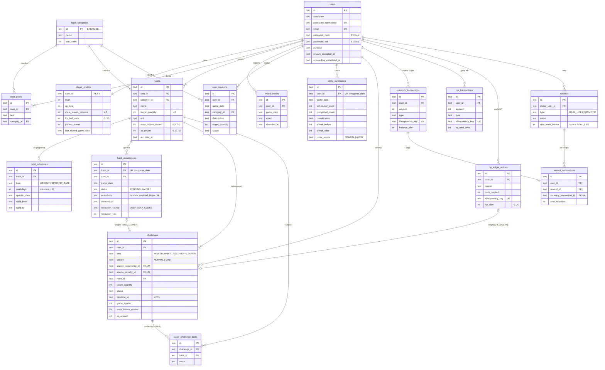

# Modelo de datos — The Life Game

> Equipo TechPhic · v1.3 (2026-11-26, Fase 1) · **Estado: APROBADO por el equipo (2026-11-26).**

> La DDL ejecutable está en [`docs/schema/sqlite_v1.sql`](schema/sqlite_v1.sql). Se validó con SQLite 3.50 contra 40 casos (datos válidos aceptados; violaciones de INT-01, 02, 03, 04, 05, 06, 09 y C-30 rechazadas). En la Fase 3 se copia como la migración `001` de la app. **[R]** marca una recomendación técnica y **[P-xx]** una decisión del equipo.

## 0. Cambio clave de la v1.3: Entrega 1 sin backend (P-57)

El profesor indicó que **la Entrega 1 no lleva backend**: la app funciona **sola en el teléfono**. Consecuencias para el modelo:

| Antes (v1.2) | Ahora (v1.3, Entrega 1) | Después de la entrega |
|---|---|---|
| El servidor registra e inicia sesión; `password_hash` solo en MySQL. | `users` vive en **SQLite** con `password_hash` + `password_salt` (SHA-256 con sal, `expo-crypto`). | El backend (bcryptjs) pasa a ser el dueño de la contraseña y la app elimina esas columnas. |
| Token opaco en SecureStore y `auth_sessions` en el servidor. | SecureStore guarda solo el **id del usuario activo**. Sin `auth_sessions`. | `auth_sessions` en MySQL y token opaco (R-16). |
| Respaldo por instantánea (`user_backups`). | **Sin respaldo.** Cerrar sesión no borra nada: los datos siguen en SQLite y vuelven al iniciar sesión en el mismo teléfono (RN-AUTH-08 se cumple localmente). | `user_backups` y luego sincronización (Fase 11). |

**El modelo lógico es el mismo para SQLite y para MySQL.** Cuando llegue el backend (con la IP, el puerto, el usuario y la contraseña del servidor del profesor), se crean en MySQL las mismas tablas con los tipos de la §1 más `auth_sessions` y `user_backups`.

## 1. Convenciones

| Aspecto | Convención | Motivo |
|---|---|---|
| Entidades | `PascalCase` en singular: `HabitOccurrence` | Coherencia con el Doc §15.2. |
| Tablas y columnas | `snake_case`, tablas en plural: `habit_occurrences.game_date` | Convención SQL. La API usa `camelCase`. |
| Identificadores | **UUID v4** generado en la app (`expo-crypto`). SQLite: `TEXT`; MySQL: `CHAR(36)`; PostgreSQL: `uuid`. | Datos creados sin conexión y portabilidad (R-05, R-30). |
| Marcas de tiempo | **UTC**. SQLite: texto ISO-8601; MySQL: `DATETIME(3)`. Sufijo `_at`. | Sin ambigüedad horaria. |
| Fecha de jornada | `game_date` (`YYYY-MM-DD`; `DATE` en MySQL). | RN-DAY-02. |
| Enumeraciones | `TEXT`/`VARCHAR` + `CHECK`, valores en `UPPER_SNAKE_CASE`. **Nunca `ENUM`.** | Portable (R-30). |
| Booleanos | SQLite: `INTEGER` 0/1; MySQL: `BOOLEAN`. | — |
| Cantidades | **Enteros**: Hojas, XP y unidades de HP. | Sin coma flotante. |
| Versionado | `version` + `updated_at` en las entidades editables. | Preparado para la sincronización. |
| Borrado | Lógico (`archived_at`) donde hay historial. Los **libros de movimientos solo admiten inserciones**. | Integridad (C-07). |
| Restricciones | Los `CHECK` y `UNIQUE` son la **red de seguridad** de las INT-xx. El dominio valida antes con los valores de `src/config/game.ts`. | Defensa en profundidad. |
| Migraciones locales | `PRAGMA user_version` + migraciones numeradas en `app/src/database/migrations/`. `PRAGMA foreign_keys = ON` en cada conexión. | Idempotentes (Fase 3). |

## 2. Diagrama entidad-relación

**Leyenda:** `||` = exactamente uno · `o|` = cero o uno · `o{` = cero o muchos · PK = clave primaria · FK = clave foránea · UK = única.

El diagrama muestra los atributos principales; la lista completa está en la §3 y en la DDL.

### 2.1. Qué tablas entran en la Entrega 1

| Grupo | Tablas | Entrega 1 |
|---|---|---|
| Cuenta | `users`, `player_profiles`, `user_goals`, `habit_categories` | **Imprescindible** |
| Hábitos | `habits`, `habit_schedules`, `habit_occurrences` | **Imprescindible** |
| Desafíos y misiones | `challenges` (MISSED_HABIT y RECOVERY), `user_missions` | **Imprescindible** |
| Economía | `currency_transactions`, `xp_transactions`, `hp_ledger_entries` | **Imprescindible** |
| Mapa | `daily_summaries` | **Imprescindible** |
| Extras | `mood_entries`, `challenges` SUPER + `super_challenge_tasks`, `rewards` (REAL_LIFE) + `reward_redemptions` | Tabla creada; la funcionalidad, si da tiempo |
| Después | `inventory_items` (cosméticos), `auth_sessions`, `user_backups` (MySQL), `sync_outbox` | Migraciones posteriores |

Crear las tablas de los extras desde la v1 cuesta poco y evita una migración el lunes por la mañana.

## 3. Entidades

### 3.1. Cuenta y perfil

#### User — cuenta
| Campo | Tipo | Notas |
|---|---|---|
| `id` | UUID | PK. |
| `username` | texto | Tal como lo escribió el usuario (se muestra). |
| `username_normalized` | texto | En minúsculas. **UNIQUE**: unicidad sin distinguir mayúsculas (RN-AUTH-02). |
| `email` | texto | Guardado en minúsculas. **UNIQUE**. |
| `password_hash`, `password_salt`, `password_algo` | texto | **Entrega 1 (P-57):** `SHA-256(sal ‖ contraseña)` con 16 bytes de sal aleatoria (`expo-crypto`), `password_algo = 'SHA256_SALT_V1'`. Con backend: bcryptjs en el servidor y estas columnas salen de la app. |
| `purpose` | texto \| null | Propósito personal (onboarding). |
| `privacy_accepted_at` | marca | Consentimiento del aviso de privacidad (C-25). |
| `onboarding_completed_at` | marca \| null | `null` = registrado pero sin terminar el onboarding: la app lo lleva a propósito y metas. |
| `created_at`, `updated_at`, `version` | — | — |

El inicio de sesión busca por `username_normalized` **o** por `email` (RN-AUTH-07) y compara el hash.

**Sesión en la Entrega 1:** SecureStore guarda `activeUserId`. Al abrir la app, si existe y el usuario existe, va a Home (RN-AUTH-04). Cerrar sesión borra solo esa clave.

#### PlayerProfile — estado de juego (1:1)
| Campo | Tipo | Notas |
|---|---|---|
| `user_id` | UUID | PK y FK. |
| `level` | entero ≥ 0 | Inicial **0** (C-05). Caché derivada de `xp_total` (P-03). |
| `xp_total` | entero ≥ 0 | Inicial **0**. |
| `mate_leaves_balance` | entero ≥ 0 | Inicial **0**. |
| `hp_half_units` | entero 0..20 | Inicial **20**. |
| `perfect_streak` | entero ≥ 0 | RN-CLOSE-07. |
| `avatar_appearance` | texto (JSON) \| null | `null` = avatar fijo (Entrega 1, P-38). |
| `last_closed_game_date` | fecha \| null | Base de la reconciliación. |
| `updated_at`, `version` | — | — |

Los valores iniciales los pone el servicio desde la configuración (sin `DEFAULT` en la tabla, para no duplicar números mágicos).

#### UserGoal — meta
`id`, `user_id` (FK), `text` (libre, P-41), `category_id` (FK → HabitCategory; sirve para los mensajes y las misiones), `sort_order`, `archived_at`, `created_at`, `updated_at`.

### 3.2. Hábitos

#### HabitCategory — catálogo
`id` (código estable, P-42 + P-59: `PERSONAL_DEVELOPMENT` (sort_order 0), `EXERCISE`, `STUDY`, `READING`, `ART`, `MINDFULNESS`, `HEALTH`, `SELF_CARE`, `HOME`, `FINANCE`, `SOCIAL`, `WORK`, `SPIRITUALITY`, `DIGITAL_WELLBEING`, `HOBBIES`, `COMMUNITY`, `OTHER`), `name` (español), `sort_order`. Se siembra en la migración `001`; la `002` añade `PERSONAL_DEVELOPMENT` (P-59) con `INSERT OR IGNORE`.

#### Habit
| Campo | Tipo | Notas |
|---|---|---|
| `id` | UUID | PK. |
| `user_id` | UUID | FK. |
| `origin` | `RECOMMENDED` \| `CUSTOM` | En la Entrega 1, solo `CUSTOM` (P-04 aplazada). |
| `category_id` | texto | FK → HabitCategory. **Obligatorio** (RN-HAB-09). |
| `name` | texto | — |
| `target_quantity` | entero > 0 | Cantidad medible (RN-HAB-08). |
| `unit` | texto | `MINUTES`, `PAGES`, `REPETITIONS`, `KILOMETERS`, `GLASSES`, `TIMES` o texto libre si es "otra". |
| `mate_leaves_reward` | entero | `CHECK IN (0,5,10,15,20,25,30)` (C-06). |
| `xp_reward` | entero | `CHECK IN (0,10,20,30,40,50)` (P-54). |
| `archived_at` | marca \| null | Eliminación lógica (R-14). |
| `created_at`, `updated_at`, `version` | — | — |

#### HabitSchedule — asignación a días
| Campo | Tipo | Notas |
|---|---|---|
| `id` | UUID | PK. |
| `habit_id` | UUID | FK. Un hábito puede tener varias programaciones. |
| `type` | `WEEKLY` \| `SPECIFIC_DATE` | — |
| `weekdays` | entero 1..127 \| null | Máscara de 7 bits: bit 0 = lunes … bit 6 = domingo. Ej.: L-M-V = 1 + 4 + 16 = **21**. |
| `specific_date` | fecha \| null | — |
| `valid_from`, `valid_to` | fecha, fecha \| null | Vigencia (`null` = sin fin). Editar la programación cierra la anterior (`valid_to`) y abre otra: así el historial no cambia (C-07). |

`CHECK`: `WEEKLY` exige `weekdays` y no `specific_date`; `SPECIFIC_DATE`, lo contrario.

#### HabitOccurrence — historial de cumplimiento
| Campo | Tipo | Notas |
|---|---|---|
| `id` | UUID | PK. Base de las claves de idempotencia. |
| `user_id`, `habit_id` | UUID | FK. |
| `game_date` | fecha | — |
| `status` | `PENDING` \| `COMPLETED` \| `MISSED` \| `CANCELLED` \| `PAUSED` | `PAUSED`: jornada a 0 HP (P-50). |
| `habit_name_snapshot`, `category_id_snapshot` | texto | Copia (R-13). |
| `target_quantity_snapshot`, `unit_snapshot` | entero, texto | Copia para calcular los desafíos. |
| `mate_leaves_reward_snapshot`, `xp_reward_snapshot` | entero | Copia (RN-HAB-05), con los mismos `CHECK` que el hábito. |
| `resolved_at` | marca \| null | Hora real del registro. Define la ventana de 10 s (RN-DAY-07). `CHECK`: es `null` **si y solo si** `status = PENDING`. |
| `resolution_source` | `USER` \| `DAY_CLOSE` \| null | Deshacer Día Finalizado devuelve a `PENDING` las de esa jornada con `DAY_CLOSE` (RN-CLOSE-09). |
| `resolution_seq` | entero ≥ 0 | **Nuevo en v1.3.** Cuántas veces se ha marcado. Forma las claves `habit-reward:<id>:<seq>` y `undo:<id>:<seq>` (ver §5). |
| `created_at`, `updated_at`, `version` | — | — |

Restricciones: `UNIQUE(habit_id, game_date)` (P-43). Índice `(user_id, game_date)`.

### 3.3. Estado de ánimo (extra)

#### MoodEntry
`id`, `user_id`, `game_date`, `mood` (`VERY_HAPPY` \| `GOOD` \| `NEUTRAL` \| `DOWN` \| `VERY_BAD`), `recorded_at`. Varios por jornada; el **último** prevalece (C-28). Índice `(user_id, game_date, recorded_at)`.

### 3.4. Desafíos

#### Challenge
| Campo | Tipo | Notas |
|---|---|---|
| `id` | UUID | PK. |
| `user_id` | UUID | FK. |
| `kind` | `MISSED_HABIT` \| `RECOVERY` \| `SUPER` | — |
| `variant` | `NORMAL` \| `MINI` \| null | Solo `MISSED_HABIT`. **Mutable** mientras la jornada de origen esté abierta (RN-MOOD-08). Sin ánimo registrado: `NORMAL`. |
| `source_occurrence_id` | UUID \| null | FK. **UNIQUE** (R-15). Obligatorio en `MISSED_HABIT`. |
| `source_game_date` | fecha \| null | Jornada de origen (`MISSED_HABIT`). |
| `source_penalty_id` | UUID \| null | FK → HpLedgerEntry. **UNIQUE**. Obligatorio en `RECOVERY`: la vida perdida que lo originó (P-12). |
| `habit_id` | UUID \| null | Hábito relacionado (`MISSED_HABIT` y `RECOVERY`). |
| `title`, `target_quantity`, `unit` | texto, entero, texto | Acción y criterio medible (P-07). `null` solo en `SUPER` (el criterio está en sus tareas). |
| `status` | `PENDING` \| `COMPLETED` \| `DECLINED` \| `EXPIRED` \| `CANCELLED` | `BUSINESS_RULES.md` §16. |
| `deadline_at` | marca \| null | `created_at + 72 h` en `MISSED_HABIT`; `null` en `RECOVERY` y `SUPER`. |
| `grace_applied` | booleano | Gracia de 12 h ya usada (INT-18). |
| `declined_at` | marca \| null | Rechazo del mini. |
| `mate_leaves_reward`, `xp_reward` | entero ≥ 0 | `floor(Hojas / 2)` y 20 % de la XP de la ocurrencia (C-27). `SUPER`: 0 y 0. |
| `completed_at`, `resolved_at` | marca \| null | — |
| `created_at`, `updated_at`, `version` | — | — |

Restricciones (todas en la DDL):
- Un `CHECK` por tipo fija qué campos son obligatorios o nulos en `MISSED_HABIT`, `RECOVERY` y `SUPER` (RN-DES-02).
- `UNIQUE(source_occurrence_id)` y `UNIQUE(source_penalty_id)`: admiten varios `NULL`.
- **Un `SUPER` en `PENDING` por usuario:** índice único **parcial** en SQLite (`WHERE kind='SUPER' AND status='PENDING'`). MySQL no los admite: allí se valida en el servicio.
- **Deshacer** un incumplimiento dentro de los 10 s **borra** el desafío recién creado (aún no tiene efectos), para que un nuevo incumplimiento pueda crear otro sin chocar con el `UNIQUE`. Lo mismo hace deshacer Día Finalizado con los desafíos que creó (RN-CLOSE-09).

#### SuperChallengeTask (extra)
`id`, `challenge_id` (FK → `SUPER`), `habit_id` (FK; uno por hábito activo, P-13), `title`, `target_quantity`, `unit`, `status` (`PENDING` \| `COMPLETED`), `completed_at`. `UNIQUE(challenge_id, habit_id)`. El Superdesafío se completa cuando **todas** están `COMPLETED`.

### 3.5. Misiones secundarias

#### UserMission
| Campo | Tipo | Notas |
|---|---|---|
| `id` | UUID | PK. |
| `user_id` | UUID | FK. |
| `game_date` | fecha | Límite de **3 no abandonadas por `(user_id, game_date)`**, validado en el servicio (INT-20, P-58). |
| `category_id` | texto | FK → HabitCategory. |
| `description` | texto | Sugerida por la app y **editable** (C-31). |
| `target_quantity`, `unit` | entero, texto | Criterio medible. |
| `mate_leaves_reward`, `xp_reward` | entero | Copia de **20 / 20** (configurable). |
| `status` | `ACCEPTED` \| `COMPLETED` \| `ABANDONED` | `CHECK`: `completed_at` existe si y solo si `COMPLETED`. Pasa a `ABANDONED` a mano o en el cierre de la jornada (RN-MIS-06). |
| `accepted_at`, `completed_at` | marca | — |

Las sugerencias salen de plantillas en `src/content/` a partir de las metas y los hábitos de la categoría; no hace falta tabla de catálogo.

### 3.6. Tienda

#### Reward (extra: solo `REAL_LIFE` en la Entrega 1)
`id`, `owner_user_id` (FK; `null` en cosméticos), `type` (`REAL_LIFE` \| `COSMETIC`), `name`, `description`, `cost_mate_leaves`, `min_level` y `cosmetic_slot` (solo `COSMETIC`), `asset_key`, `is_active`, `archived_at`, `created_at`, `updated_at`.

Restricciones: `CHECK (type = 'REAL_LIFE' OR owner_user_id IS NULL)`; `CHECK (type = 'COSMETIC' OR (min_level IS NULL AND cosmetic_slot IS NULL))`; `CHECK (cost_mate_leaves > 0 AND (type <> 'REAL_LIFE' OR cost_mate_leaves >= 20))` (C-30).

#### RewardRedemption — canje
`id` (= `operationId`), `user_id`, `reward_id`, `name_snapshot`, `cost_snapshot`, `currency_transaction_id` (FK, **UNIQUE**), `redeemed_at`. Canjes ilimitados, cada uno con su ID.

#### InventoryItem (después de la entrega)
`id`, `user_id`, `reward_id` (**UNIQUE(user_id, reward_id)**), `cosmetic_slot`, `is_equipped` (uno por ranura, en el servicio), `acquired_at`, `currency_transaction_id`. Se crea en una migración posterior.

### 3.7. Jornadas

#### DailySummary
| Campo | Tipo | Notas |
|---|---|---|
| `id` | UUID | PK. |
| `user_id` | UUID | FK. |
| `game_date` | fecha | **UNIQUE(user_id, game_date)** (INT-09). |
| `scheduled_count`, `completed_count`, `missed_count` | entero | Se guarda la fracción (clasificación sin redondear). `CHECK (completed + missed <= scheduled)`. |
| `classification` | `PERFECT` \| `VERY_GOOD` \| `PARTIAL` \| `CRITICAL` \| `NO_ACTIVITY` \| `PAUSED` | — |
| `last_mood` | enum \| null | Último ánimo de la jornada (RN-MAP-08). |
| `streak_before` | entero | **Nuevo en v1.3.** Racha antes del cierre: deshacer Día Finalizado la restaura exactamente (RN-CLOSE-09, INT-19). |
| `streak_after` | entero | — |
| `message_id` | texto \| null | Mensaje mostrado (ID del JSON). |
| `close_source` | `MANUAL` \| `AUTO` | Solo el `MANUAL` se puede deshacer. |
| `closed_at` | marca | — |

### 3.8. Libros de movimientos (solo se insertan filas)

| Entidad | Campos | Tipos de movimiento |
|---|---|---|
| **CurrencyTransaction** | `id`, `user_id`, `amount` (con signo, ≠ 0), `type`, `source_type`, `source_id`, `idempotency_key` **UNIQUE**, `balance_after` (≥ 0), `created_at` | `HABIT_REWARD`, `CHALLENGE_REWARD`, `MISSION_REWARD`, `REWARD_REDEMPTION`, `COSMETIC_PURCHASE`, `UNDO_REVERSAL` |
| **XpTransaction** | `id`, `user_id`, `amount`, `type`, `source_type`, `source_id`, `idempotency_key` **UNIQUE**, `xp_total_after` (≥ 0), `created_at` | `HABIT_REWARD`, `CHALLENGE_REWARD`, `MISSION_REWARD`, `UNDO_REVERSAL` |
| **HpLedgerEntry** | `id`, `user_id`, `reason`, `delta_requested`, `delta_applied`, `source_type`, `source_id`, `idempotency_key` **UNIQUE**, `hp_after` (0..20), `created_at` | `MISSED_HABIT_PENALTY`, `RECOVERY`, `ZERO_HP_RECOVERY`, `SUPER_CHALLENGE` |

`source_type` + `source_id` son una **referencia polimórfica** (pueden apuntar a una ocurrencia, un desafío, una misión o un canje), por eso no llevan FK. La integridad la da la clave de idempotencia.

**Deshacer** (RN-DAY-07) no borra movimientos: inserta un `UNDO_REVERSAL` compensatorio.

### 3.9. Configuración y contenido (datos en la app, sin tabla)

| Entidad | Contenido |
|---|---|
| **LevelThreshold** | `level`, `xp_required_total` = `40·n² + 60·n` (P-03). Generada desde `src/config/game.ts`. |
| **MotivationalMessage** | `id`, `text`, `context`, `mood`, `performance`, `category_id`, `tone`. JSON local (P-32). |
| **CosmeticCatalog** | Después de la entrega (P-16). |

### 3.10. Servidor (después de la Entrega 1)

| Entidad | Notas |
|---|---|
| **AuthSession** | `id`, `user_id`, `token_hash` (SHA-256 del token opaco, **UNIQUE**), `expires_at` (+30 días, R-16), `revoked_at`, `created_at`, `last_used_at`. |
| **UserBackup** | `user_id` (PK), `snapshot` (`LONGTEXT` JSON), `schema_version`, `checksum`, `size_bytes`, `updated_at` (R-29). |
| **SyncOutbox**, **SyncState**, **ProcessedOperation** | Fase 11. |

## 4. Dónde vive cada dato

| Entidad | Entrega 1 | Con backend |
|---|---|---|
| User (con hash y sal) | **SQLite** | MySQL dueño de la contraseña; la app guarda el perfil sin contraseña. |
| Sesión | SecureStore: `activeUserId` | SecureStore: token; MySQL: `auth_sessions`. |
| Todo el juego (perfil, metas, hábitos, ocurrencias, ánimo, desafíos, misiones, resúmenes, libros, recompensas) | **SQLite** | SQLite + respaldo en MySQL (instantánea, luego sincronización). |
| HabitCategory | SQLite (sembrada) | Sembrada también en MySQL. |
| Mensajes, niveles | Incluidos en la app | — |
| Preferencias de interfaz | kv-store de `expo-sqlite` o AsyncStorage | — |

## 5. Claves de idempotencia

| Efecto | Clave |
|---|---|
| Hábito cumplido (Hojas + XP) | `habit-reward:<occurrenceId>:<seq>` |
| Deshacer el marcado | `undo:<occurrenceId>:<seq>` |
| Desafío completado (½ Hojas + 20 % XP) | `challenge-reward:<challengeId>` |
| Pérdida por desafío vencido | `hp-penalty:<occurrenceId>` |
| Recuperación | `hp-recovery:<challengeId>` |
| Recuperación a 0 HP | `hp-zero-recovery:<challengeId>` |
| Superdesafío | `hp-super:<challengeId>` |
| Misión secundaria | `mission-reward:<userMissionId>` |
| Canje | `redeem:<redemptionId>` |
| Compra de cosmético | `cosmetic:<userId>:<rewardId>` |

**Por qué `<seq>` (corrección de la v1.3):** con la clave `habit-reward:<occurrenceId>` de la v1.2, si el usuario marca un hábito como cumplido, lo deshace y lo vuelve a marcar, la segunda acreditación **chocaría con el `UNIQUE`** y no se pagaría. Con `resolution_seq` cada marcado tiene su propia clave, y repetir **la misma** operación (doble toque, reintento) sigue sin duplicar nada (INT-01).

## 6. Restricciones críticas

| Invariante | Base de datos (red de seguridad) | Servicio |
|---|---|---|
| INT-01, INT-16 | `UNIQUE(idempotency_key)` | Transición solo desde `PENDING` |
| INT-02 | `UNIQUE(idempotency_key)` en HP | Resolver un vencimiento una sola vez |
| INT-03 | `CHECK` 0..20 en perfil y libro | Limitar el valor (clamp) |
| INT-04 | `CHECK` de Hojas y XP en hábitos y copias | Validación del formulario y del dominio |
| INT-05 | `CHECK (≥ 0)` en saldo y `balance_after` | Comprobar el saldo dentro de la transacción |
| INT-06 | `UNIQUE(source_occurrence_id)` + índice parcial de `SUPER` | — |
| INT-09 | `UNIQUE(user_id, game_date)` | `last_closed_game_date` |
| INT-17 | — | `hp_half_units > 0` en cada acción bloqueable |
| INT-18 | `grace_applied` | Aplicar la gracia solo si es `false` |
| INT-19 | `streak_before`, `resolution_source` | `undoDayClose` |
| INT-20 | Índice `(user_id, game_date)` | Contar antes de insertar |

## 7. Decisiones abiertas que afectan al modelo

Solo P-38 (apariencia del avatar, después de la Entrega 1). La conexión a MySQL (IP, puerto, usuario y contraseña del profesor) no afecta al modelo lógico.

## 8. Historial de cambios

| Fecha | Cambio |
|---|---|
| 2026-11-26 | **v1.3 (Fase 1):** Entrega 1 sin backend (P-57): `users` local con hash y sal, sesión por `activeUserId`, sin respaldo. Nuevas columnas `onboarding_completed_at`, `resolution_seq`, `streak_before`; claves de idempotencia con `<seq>`; `CHECK` por tipo de desafío; índice parcial del Superdesafío; diagrama ER con atributos; DDL validada en `docs/schema/sqlite_v1.sql`. |
| 2026-11-25 | v1.2: 16 categorías; XP en pasos de 10; recompensa de los desafíos; recuperación por vida perdida; 3 misiones al día; recompensa real ≥ 20; deshacer el cierre; cosméticos fuera de la Entrega 1. |
| 2026-11-27 | Fase 4/5: migración local `002` (categoría `PERSONAL_DEVELOPMENT`, P-59). Con R-34, `onboarding_completed_at = NULL` solo queda en cuentas creadas antes del cambio. |
| 2026-11-25 | v1.1: hábitos medibles, Hojas en múltiplos de 5, nivel 0, desafío de 72 h con gracia, SuperChallengeTask, UserMission, AuthSession, UserBackup, SQL portable. |
| 2026-11-25 | Propuesta inicial (Fase 0). |
